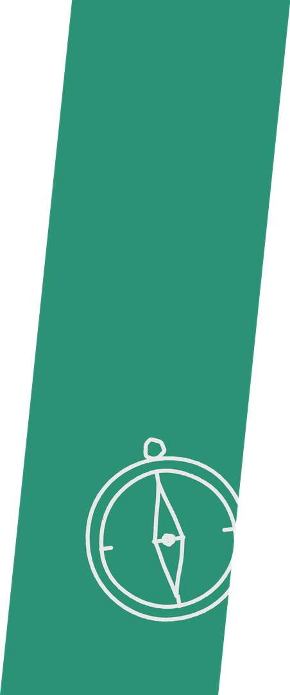
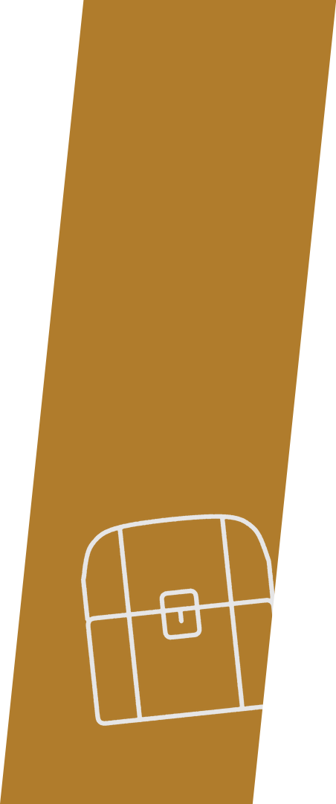

# Art Book Next collection art

Collection art for the [Art Book Next](https://github.com/anthonycaccese/art-book-next-es-de) theme by Anthony Caccese. These pictures are not part of that theme: they are LLM-generated, for my own personal use.

Generated by `tools/gen_theme_art.py`; don't edit by hand.

<table>
<tr><td align="center" valign="top"> 3D Platformers <code>3d-platformers</code></td><td align="center" valign="top"> Action Classics <code>action-classics</code></td><td align="center" valign="top"> Adventure <code>adventure</code></td><td align="center" valign="top"> Arcade Beat &#x27;Em Ups <code>arcade-brawlers</code></td><td align="center" valign="top"> Arcade Classics <code>arcade-classics</code></td><td align="center" valign="top"> Backlog <code>backlog</code></td></tr>
<tr><td align="center" valign="top"> Device Benchmarks <code>benchmarks</code></td><td align="center" valign="top"> Best of 16-Bit <code>best-of-16-bit</code></td><td align="center" valign="top"> Castlevania <code>castlevania</code></td><td align="center" valign="top"> Co-op &amp; Local Multiplayer <code>co-op</code></td><td align="center" valign="top"> Completed <code>completed</code></td><td align="center" valign="top"> Years &amp; Decades <code>decades</code></td></tr>
<tr><td align="center" valign="top"> Dungeon Crawlers &amp; Roguelikes <code>dungeon-crawlers</code></td><td align="center" valign="top"> Fan Translations <code>fan-translations</code></td><td align="center" valign="top"> Favorites <code>favorites</code></td><td align="center" valign="top"> Fighting <code>fighting</code></td><td align="center" valign="top"> Final Fantasy <code>final-fantasy</code></td><td align="center" valign="top"> First-Person Shooters <code>fps</code></td></tr>
<tr><td align="center" valign="top"> ROM Hacks &amp; Homebrew <code>hacks-homebrew</code></td><td align="center" valign="top"> Handheld Greatest Hits <code>handheld-greatest-hits</code></td><td align="center" valign="top"> Hard Mode <code>hard-mode</code></td><td align="center" valign="top"> Hidden Gems <code>hidden-gems</code></td><td align="center" valign="top"> Holidays <code>holiday</code></td><td align="center" valign="top"> Horror <code>horror</code></td></tr>
<tr><td align="center" valign="top"> Imports <code>imports</code></td><td align="center" valign="top"> JRPG Essentials <code>jrpg-essentials</code></td><td align="center" valign="top"> Kart &amp; Combat Racing <code>kart-racers</code></td><td align="center" valign="top"> Kids &amp; Family <code>kids</code></td><td align="center" valign="top"> Kirby <code>kirby</code></td><td align="center" valign="top"> Late Night &amp; Chill <code>late-night</code></td></tr>
<tr><td align="center" valign="top"> Disney &amp; Licensed Classics <code>licensed-classics</code></td><td align="center" valign="top"> Simulation &amp; Life Sims <code>life-sim</code></td><td align="center" valign="top"> Light Gun &amp; Rail Shooters <code>light-gun</code></td><td align="center" valign="top"> Mario <code>mario</code></td><td align="center" valign="top"> Mega Man <code>mega-man</code></td><td align="center" valign="top"> Metroid <code>metroid</code></td></tr>
<tr><td align="center" valign="top"> Metroidvanias <code>metroidvanias</code></td><td align="center" valign="top"> Now Playing <code>now-playing</code></td><td align="center" valign="top"> Pinball <code>pinball</code></td><td align="center" valign="top"> Platformers <code>platformers</code></td><td align="center" valign="top"> Pokemon <code>pokemon</code></td><td align="center" valign="top"> Puzzle <code>puzzle</code></td></tr>
<tr><td align="center" valign="top"> Racing <code>racing</code></td><td align="center" valign="top"> Resident Evil <code>resident-evil</code></td><td align="center" valign="top"> Pre-NES &amp; Retro Oddities <code>retro-oddities</code></td><td align="center" valign="top"> Rhythm <code>rhythm</code></td><td align="center" valign="top"> RPG <code>rpg</code></td><td align="center" valign="top"> RPG Series <code>rpg-series</code></td></tr>
<tr><td align="center" valign="top"> Run &amp; Gun <code>run-and-gun</code></td><td align="center" valign="top"> Shmups <code>shmups</code></td><td align="center" valign="top"> Road Trip &amp; Short Sessions <code>short-sessions</code></td><td align="center" valign="top"> Sonic the Hedgehog <code>sonic</code></td><td align="center" valign="top"> Great Soundtracks <code>soundtracks</code></td><td align="center" valign="top"> Sports <code>sports</code></td></tr>
<tr><td align="center" valign="top"> Star Wars <code>star-wars</code></td><td align="center" valign="top"> Stealth &amp; Espionage <code>stealth</code></td><td align="center" valign="top"> Strategy &amp; Tactics <code>strategy-tactics</code></td><td align="center" valign="top"> Street Fighter <code>street-fighter</code></td><td align="center" valign="top"> Surprise <code>surprise</code></td><td align="center" valign="top"> Survival Horror <code>survival-horror</code></td></tr>
<tr><td align="center" valign="top"> System Essentials <code>system-essentials</code></td><td align="center" valign="top"> The Legend of Zelda <code>zelda</code></td></tr>
</table>
